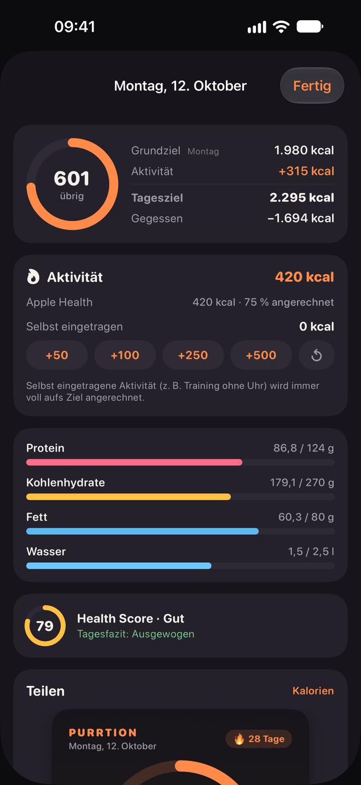
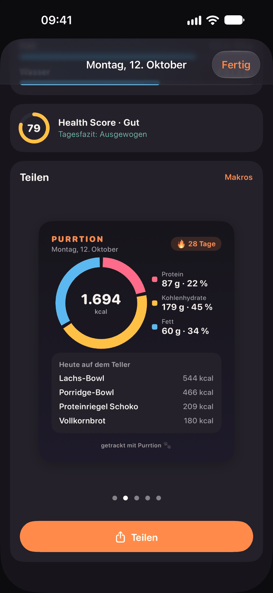

# Purrtion 🐾

Kalorientracker für iPhone (SwiftUI, SwiftData, iOS 27+, optimiert für iPhone 17/18 Pro Max) und Android (Kotlin, Jetpack Compose, ab Android 9), komplett im Pixel-Katzen-Look.
Keine laufenden Kosten, kein Account, alle Daten bleiben auf dem Gerät.

**Version 2.4.4** – siehe [CHANGELOG.md](CHANGELOG.md).

## Installieren

Die fertigen Dateien liegen immer beim neuesten [Release](https://github.com/Congamer69/Purrtion/releases/latest). Beide Apps brauchen keinen Account und keine Gebühren.

### Android (ab Android 9)
1. Auf dem Handy die [neueste `Purrtion-<Version>.apk`](https://github.com/Congamer69/Purrtion/releases/latest) laden und öffnen.
2. Android fragt einmal, ob dein Browser oder Dateimanager Apps installieren darf. Erlauben und installieren.
3. **Updates** kommen in der App selbst: Einstellungen → App-Update. Die App prüft GitHub, lädt die neue APK, sichert vorher deine Daten und installiert sie über die alte (Daten bleiben). Wer die App nicht mehr öffnen kann, installiert die neue APK einfach von Hand über die alte.
4. Stürzt die App ab, zeigt sie einen Bericht zum Kopieren und startet auf Wunsch abgesichert (Einstellungen → Diagnose zeigt ihn später noch einmal).

### iPhone (iOS 27, kostenlos mit SideStore)
Mit einer normalen Apple-ID, ohne Entwicklerkonto. SideStore installiert das IPA und hält es aktuell.
1. [SideStore](https://docs.sidestore.io) einmalig auf dem iPhone einrichten (Anleitung dort).
2. In SideStore unter „Quellen“ auf „+“ tippen und diese Adresse einfügen:
   `https://raw.githubusercontent.com/Congamer69/Purrtion/main/distribution/sidestore-source.json`
   Mit SideStore auf dem Handy geht es auch per Antippen: `sidestore://source?url=https://raw.githubusercontent.com/Congamer69/Purrtion/main/distribution/sidestore-source.json`
3. Purrtion in der Quelle antippen und „Laden“.
4. **Updates:** Die App meldet beim Start und unter Profil → App-Update eine neuere Version. „SideStore öffnen“ startet SideStore. Dort unter „Meine Apps“ nach unten ziehen und bei Purrtion „Update“ tippen, das installiert das neue IPA über die alte App.
5. **Apple Health braucht ein angepasstes SideStore.** Das offizielle SideStore fragt für kostenlose Konten bei Apple nur App-Gruppen und Inter-App-Audio an, nie HealthKit. Dann meldet Purrtion „Missing com.apple.developer.healthkit entitlement“ und Gewicht, Ernährung und Aktivitätskalorien aus Health fehlen (sonst läuft die App vollständig). Mit einem kleinen Patch fragt SideStore HealthKit an, dann geht alles: [SideStore mit HealthKit selbst bauen](distribution/sidestore-healthkit/README.md). Alternativ Purrtion per Xcode installieren (siehe „Mit Xcode auf dem iPhone“, 7-Tage-Signatur, Mac nötig).
6. Das kostenlose Apple-Konto läuft nach 7 Tagen ab. SideStore erneuert automatisch im Hintergrund. Erlaubt sind höchstens 3 Apps gleichzeitig.

Mehr (Release machen, Fehlersuche, Grenzen): [distribution/README.md](distribution/README.md). Auf Mac mit Xcode geht auch der Weg unten unter „Selbst bauen“. Eine Xcode-Installation und eine SideStore-Installation sind getrennte Apps mit getrennten Daten, nimm bei einem Wechsel die Sicherung.

### Freunde-Server verbinden
Die Apps enthalten keinen Server. Wer die Freunde-Seite nutzen will, fügt den Server-Code unter Einstellungen → Freunde ein (in beiden Apps gleich). Ohne Code ist die Seite ausgeblendet.

### Sicherung und Umzug
Einstellungen → Daten & Backup (iPhone) bzw. Sicherung (Android): Ordner wählen, täglich automatisch sichern, später wiederherstellen. Das Format ist auf beiden Systemen gleich, ein Umzug zwischen iPhone und Android geht also auch.
Optional: **Freunde-Konto mitsichern.** Deine Freunde-Anmeldung kommt dann verschlüsselt (Passwort, AES-256) in die Sicherung, damit nach einer Neuinstallation oder einem Wechsel zu SideStore dasselbe Profil und dieselben Freunde zurückkommen. Das Passwort legst du selbst fest, es steht nicht in der Sicherung und lässt sich nicht zurückholen.

## Highlights
- Eine einfache Liste pro Tag statt Frühstück/Mittag/Abend; Rezepte und Foto-Scans bleiben ein Eintrag mit ausklappbaren Zutaten
- Schnelle Eingabe: Suche, Barcode, Foto vom Teller, Schnell-Eintrag, Favoriten, „Nochmal“ per Wischen
- Makro- und Mikronährstoffe aus Bundeslebensmittelschlüssel und Schweizer Nährwertdatenbank (offline), echte Portionsgrößen
- Fehlertolerante Suche; was keine Datenbank kennt, schätzt die KI – auch ganze Sätze wie „2 Eier und ein Toast“
- Ziel pro Wochentag, Aktivitätskalorien aus Apple Health (optional aufs Ziel angerechnet), Zieländerungen gelten ab heute
- Verlauf mit Zielfarben (grün / orange bis +5 % / rot), Kaloriendefizit und Diagrammen zum Gedrückthalten und Durchwischen
- Tagesübersicht mit fünf Share-Designs für WhatsApp, Instagram & Co.
- „Tag abschließen“: KI ergänzt fehlende Mikronährstoffe und gibt ein kurzes Tagesfazit – auf Wunsch automatisch jede Nacht für den Vortag
- **Echter Verbrauch:** aus Essen und Gewichtstrend gemessener Tagesverbrauch, aufgeteilt in Grundumsatz, Verdauung und Bewegung – inklusive Abgleich mit Apple Health
- **Was passt noch?** schlägt Favoriten und Rezepte vor, die zu den restlichen Kalorien und Makros passen
- Promille-Schätzung für eingetragene Getränke (Körperwasser nach Watson, Verlauf und „nüchtern ab“)
- Health Score (mit Abzug für Alkohol), Wasser, Gewicht und Ernährung in Apple Health, Widgets, Backup und CSV-Export
- **Freunde:** per Link oder Code einladen, Rangliste über zehn Kennzahlen (Serie, Zieltreue, Health Score, Protein, Wasser, Aktivität, Obst & Gemüse …), Wochenvergleich und Duell-Ansicht – nur Kennzahlen werden geteilt, Backend gratis auf Firebase ([backend/README.md](backend/README.md))
- Hell- und Dunkelmodus, Pixel-Katze mit vielen Stimmungen – gähnend, hungrig, beschwipst, stolz, vollgefressen …

## Screenshots

<table>
  <tr>
    <td align="center" width="25%"> <b>Heute</b></td>
    <td align="center" width="25%"> <b>Mahlzeiten</b></td>
    <td align="center" width="25%"> <b>Suche</b></td>
    <td align="center" width="25%"> <b>Tagesübersicht</b></td>
  </tr>
  <tr>
    <td align="center" width="25%"> <b>Verlauf</b></td>
    <td align="center" width="25%"> <b>Teilen</b></td>
    <td align="center" width="25%"> <b>Health Score</b></td>
    <td align="center" width="25%"> <b>Widget</b></td>
  </tr>
</table>

## Selbst bauen
Voraussetzung: Xcode 27 und iOS 27 (Simulator oder iPhone).

### iPhone / Simulator
- In Xcode: `Purrtion.xcodeproj` öffnen → Simulator wählen → ▶︎
- Oder per Terminal (baut und startet im laufenden Simulator): `./run.sh`

> Das Projekt liegt in einem iCloud-synchronisierten Ordner. Build-Produkte im Projektordner
> brechen dort die Code-Signatur ("resource fork … not allowed") – `run.sh` legt sie deshalb in `$TMPDIR` ab.

### Android
Die Android-App liegt in [`android/`](android/README.md) und wird mit `android/run.sh` gebaut und auf Emulator oder Handy gestartet.
Sie nutzt dieselben Datenbanken, dieselbe Versionsnummer, dasselbe Sicherungsformat und dasselbe Freunde-Backend wie die iPhone-App.

## Datenquellen (alles kostenlos, in Einstellungen → Datenquellen einzeln abschaltbar)
| Quelle | Wofür |
|---|---|
| **Schweizer Nährwertdatenbank** (BLV, V 7.1) | ~1.200 Lebensmittel, darunter ~150 fertige Gerichte (Burger, Kebab, Pizza, Gratins …), offline in `Purrtion/Resources/swiss.json` |
| **Restaurantketten** (McDonald's, Burger King) | ~370 Produkte mit den offiziellen Nährwerten und Portionsgrößen der Ketten, offline in `Purrtion/Resources/restaurants.json`. „mcdonalds pommes“ oder „bk whopper“ zeigt die Kette zuerst, der Kettenname allein die ganze Karte |
| KI-Schätzung | alles ohne Datenbankeintrag oder ganze Sätze („2 Eier und ein Toast“), nutzt den KI-Anbieter der Foto-Erkennung |
| **Bundeslebensmittelschlüssel 4.0** (Max Rubner-Institut, CC BY 4.0) | ~7.100 Lebensmittel mit bis zu 138 Nährstoffen, offline in `Purrtion/Resources/bls.json` |
| Purrtion-Beliebtliste (`PopularFoods.swift`) | ~100 Alltagslebensmittel mit Namen & echten Portionsgrößen, auf BLS-Einträge gemappt |
| Open Food Facts | Barcodes & Markenprodukte, deutsche Produkte bevorzugt, unplausible Werte markiert |

BLS aktualisieren: Excel von https://blsdb.de laden und
`python tools/convert_bls.py BLS_4_0_Daten_2025_DE.xlsx Purrtion/Resources/bls.json` (braucht `openpyxl`).
Schweizer Datenbank aktualisieren: Excel von https://naehrwertdaten.ch/de/downloads/ laden und
`python tools/convert_swiss.py Schweizer_Nahrwertdatenbank.xlsx Purrtion/Resources/swiss.json`.

Restaurantketten aktualisieren: `python3 tools/restaurants/build_restaurants.py` holt Burger King direkt von burgerking.de. McDonald's blockt Skripte, deshalb einmal `tools/restaurants/mcdonalds_scrape.js` in der Browser-Konsole auf mcdonalds.com ausführen und die Ausgabe nach `tools/restaurants/raw/mcdonalds.jsonl` kopieren. Danach `python tools/update_manifest.py`.

Die App lädt neue Datenbank-Versionen selbst nach (Einstellungen → Datenquellen → „Datenbanken aktualisieren“, automatisch wöchentlich): `data/manifest.json` nennt Version und Revision jeder Datei, `python tools/update_manifest.py` aktualisiert es nach einer neuen Konvertierung. Die GitHub-Aktion `.github/workflows/update-databases.yml` übernimmt neue Versionen der Schweizer Datenbank monatlich automatisch.

Die Suche verzeiht Tippfehler, Mehrzahl und getrennte Wörter („Käsespätzle“ findet „Spätzle mit Käse“).

## KI (Einstellungen → KI-Modelle)
Foto-Erkennung und Tagesanalyse („Tag abschließen“) können unterschiedliche Anbieter und Modelle nutzen – z. B. Claude Opus für Fotos und das günstigere Sonnet oder Gemini für die Tagesanalyse. Standardmäßig folgt die Tagesanalyse der Foto-Erkennung.

| Anbieter | Kosten |
|---|---|
| Apple Intelligence (Standard) | kostenlos, auf dem iPhone; Fallback: Apples Vision-Bilderkennung |
| Google Gemini | kostenloses Kontingent mit eigenem Schlüssel |
| Claude (Anthropic) | ein paar Cent pro Foto, eigener Schlüssel |
| OpenAI | ca. 1 Cent pro Foto, eigener Schlüssel |

Die KI zerlegt das Gericht in seine Bestandteile (inkl. Soßen, Öl, Beilagen) und schätzt für jeden die Menge
sowie Kalorien, Makros und – wo sinnvoll – Mikronährstoffe selbst. So bekommt z. B. „Schnitzel paniert“ eine
eigene Schätzung statt eines nur ungefähr passenden Datenbankeintrags. Vor dem Eintragen lässt sich jeder
Bestandteil anpassen, abwählen oder durch ein Lebensmittel aus der Datenbank ersetzen; die Mahlzeit landet
als ein Eintrag mit ausklappbaren Zutaten unter „Gegessen“.
Nur der Offline-Fallback (Apples Vision-Bilderkennung) erkennt lediglich das Lebensmittel und nimmt die Nährwerte aus dem BLS.
Schlüssel liegen in der Keychain und gelten pro Anbieter für beide Aufgaben; das Modell ist pro Aufgabe wählbar (Vorschläge im Menü oder eigene Modell-ID).

## Weitere Funktionen
- **Health Score (0–100):** acht Bereiche nach WHO, DGE, GBD 2017 (Lancet 2019) und EU-NRV – `Services/HealthScore.swift`
- **Eigene Lebensmittel & Rezepte** (Meal Prep mit Portionen) – `Models/CustomFood.swift`, `Views/CustomFoodViews.swift`
- **Sicherung:** JSON-Backup etwa täglich in einen gewählten (iCloud-Drive-)Ordner + Wiederherstellen – `Services/Backup.swift`
- **CSV-Export** (Essen, Tage, Gewicht; Semikolon + deutsches Komma für Excel)
- **Apple Health:** Gewicht in beide Richtungen – `Services/HealthSync.swift`; Aktivitäts- und Ruheenergie lesen, Aktivität per Slider (0–100 %) aufs Ziel anrechnen, eigene Aktivität ergänzen – `Services/ActivityStore.swift`
- **Kaloriendefizit:** Gesamtverbrauch (Grundumsatz + Aktivität) minus gegessen, für abgeschlossene Tage; ohne Health-Daten wird der Grundumsatz nach Mifflin-St Jeor geschätzt
- **Tagesübersicht & Teilen:** obere Karte auf „Heute“ antippen – Zielaufbau, Aktivität, Makros und fünf Share-Bilder (Kalorien, Makros, Health Score, Woche, Story) – `Views/DayOverviewViews.swift`
- **Diagramme erkunden:** gedrückt halten und wischen wie in Health/Fitness, mit Haptik – `Views/ChartScrub.swift`
- **Ziele:** eigenes Kalorienziel pro Wochentag; Zieländerungen gelten ab heute, vergangene Tage behalten ihr damaliges Ziel – `Models/Goals.swift`
- **Widgets:** Homescreen (quadratisch, breit) und Sperrbildschirm – Ziel `PurrtionWidget`, Daten über App Group `group.com.const.purrtion`

## Freunde (Reiter „Freunde“, in den Einstellungen ausblendbar)
Vergleiche dich mit Freunden, ohne Account und ohne laufende Kosten.

- **Einladen:** „Einladen“ teilt einen Link wie `https://purrtion-friends.web.app/f/ABCD2345?n=Name` per WhatsApp, iMessage & Co. Der Link öffnet eine kleine Seite und von dort Purrtion. Alternativ den 8-stelligen Code unter „Code“ eintippen.
- **Anfragen:** Wer eingeladen wird, sieht die Anfrage mit Name und Katze und kann annehmen oder ablehnen. Erst wenn beide sich hinzugefügt haben, sieht man gegenseitig Werte.
- **Heute:** gegessene kcal und Tagesziel (inklusive angerechneter Aktivität) aller Freunde, in Zielfarben.
- **Rangliste** über zehn Kennzahlen: Serie, Tage im Ziel (7 Tage), Health Score, Protein, Wasser, Aktivität, Obst & Gemüse, Ballaststoffe, Zieltreue und Fleiß (30 Tage). Medaillen, gleiche Werte teilen sich den Platz.
- **Diese Woche:** die letzten 7 Tage aller Freunde nebeneinander in Zielfarben.
- **Duell:** Freund antippen zeigt einen Punktestand („5 : 4“) und jede Kennzahl im direkten Vergleich mit Krone für den Gewinner.
- **Katzen:** Jeder Freund erscheint mit seiner Katzenfarbe und der Stimmung seines Tages.
- **Einstellungen → Freunde:** Seite ein- oder ausblenden, Name für Freunde, Gewichtstrend teilen (aus), eigener Code, „Freunde-Daten löschen“ (löscht Profil, Code und Konto auf dem Server).

**Datenschutz:** Geteilt werden nur Kennzahlen und die Tageskalorien mit Ziel. Keine Mahlzeiten, kein Gewicht (den Gewichtstrend in kg pro Woche nur, wenn man ihn teilt). Die Firestore-Regeln erlauben das Lesen nur Personen, die man selbst hinzugefügt hat.

**Backend:** Firebase im kostenlosen Spark-Tarif (anonyme Anmeldung, Firestore, Hosting), angesprochen per REST ohne SDK. Eigene Werte werden etwa 20 Sekunden nach einem neuen Eintrag geschrieben, höchstens alle 2 Minuten und nur bei Änderungen, alle Freunde kommen mit einer einzigen Abfrage. Aufbau, Regeln und Einrichtung für ein eigenes Projekt: [backend/README.md](backend/README.md). Die App verbindet sich über einen Server-Code (Einstellungen → Freunde → Server-Code einfügen); ohne ihn ist die Freunde-Seite ausgeblendet. Die Konfiguration `Purrtion/Resources/Firebase.plist` liegt nicht im Repository.

## Mit Xcode auf dem iPhone (statt SideStore)
In Xcode beim Ziel **Purrtion** und **PurrtionWidget** unter „Signing & Capabilities“ dein Team auswählen.
App Groups und HealthKit funktionieren auch mit einem kostenlosen Apple-Account.

## Struktur
- `Shared/` – Theme, Pixel-Sprites und Widget-Datenformat (von App und Widget genutzt)
- `Purrtion/Pixel` – Animations-Views
- `Purrtion/Models` – Nährstoffe, Lebensmittel, SwiftData-Modelle, Ziele
- `Purrtion/Services` – BLS-Datenbank, Beliebtliste, Open Food Facts, Foto-Analyse (Apple/Gemini/Claude/OpenAI), Keychain
- `Purrtion/Views` – Heute, Suche, Detail, Barcode, Foto, Schnell-Eintrag, Verlauf, Freunde, Einstellungen
- `android/` – die Android-App (Kotlin, Jetpack Compose), siehe [android/README.md](android/README.md)
- `backend/` – Firebase-Regeln, Einladungsseite (Hosting) und Anleitung für die Freunde-Seite
- `tools/` – `make_icon.py` (App-Icon), `preview_sprites.py` (Sprite-Vorschau), `convert_bls.py` (BLS-Import), `export_sprites_kotlin.py` (Sprites für Android), `server_code.py` (Server-Code für die Freunde-Seite)

## Lizenz & Hinweise
Der Code steht unter der [MIT-Lizenz](LICENSE): frei nutzbar, veränderbar und weitergebbar, ohne Gewähr und ohne Haftung. Die Datenquellen haben eigene Lizenzen, siehe [NOTICE](NOTICE).

Purrtion ist ein privates Hobbyprojekt und wurde mit Unterstützung von KI (Claude Code) entwickelt.
Nährwerte, Foto-Schätzungen und der Health Score sind Richtwerte und ersetzen keine ärztliche oder ernährungsfachliche Beratung.

### Lizenzen der Daten
Bundeslebensmittelschlüssel 4.0 © Max Rubner-Institut, lizenziert unter [CC BY 4.0](https://creativecommons.org/licenses/by/4.0/).
Schweizer Nährwertdatenbank V 7.1, Bundesamt für Lebensmittelsicherheit und Veterinärwesen BLV, [naehrwertdaten.ch](https://naehrwertdaten.ch) – frei nutzbar mit Quellenangabe.
Produktdaten von [Open Food Facts](https://world.openfoodfacts.org) (ODbL), werden zur Laufzeit abgefragt.
