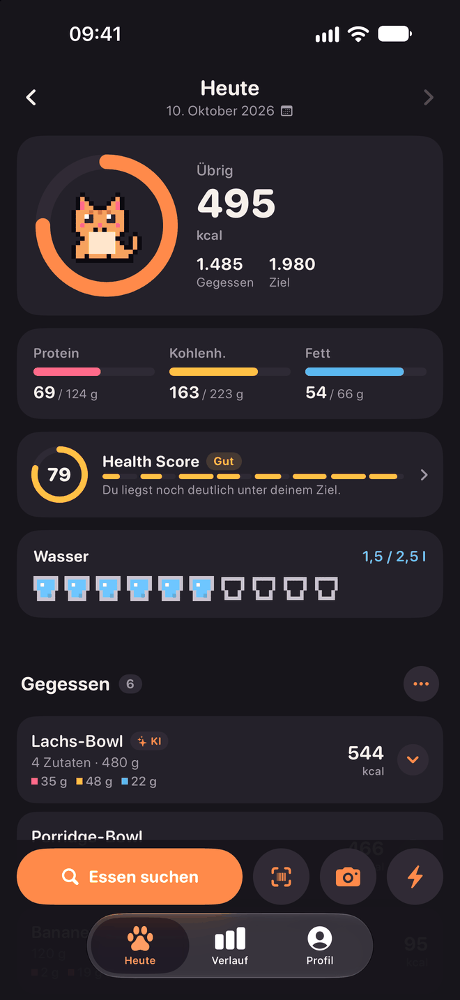
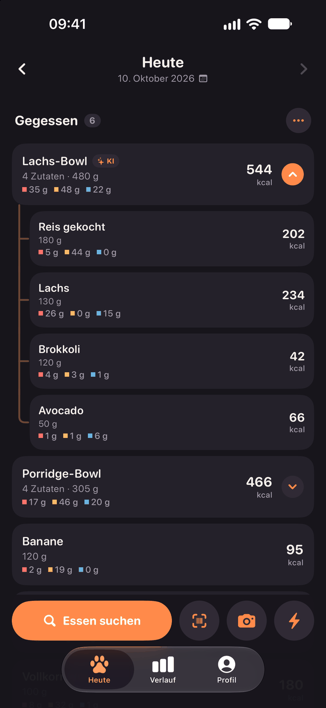
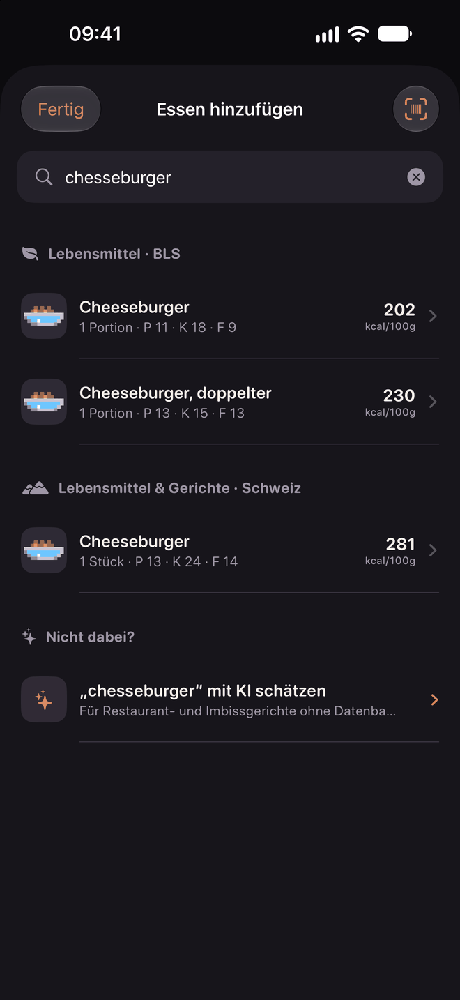
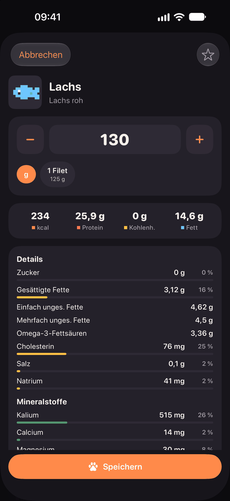
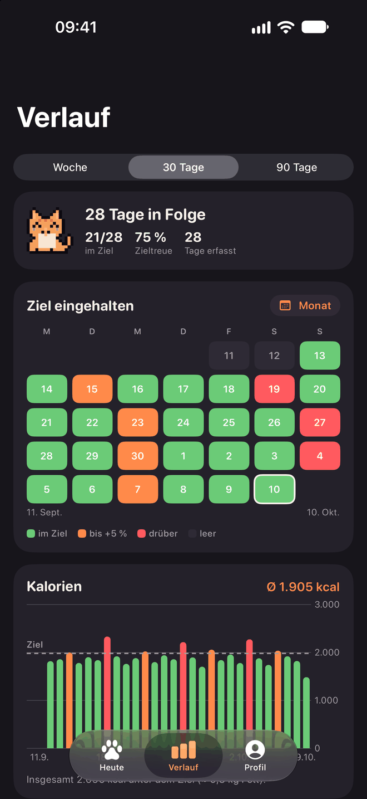
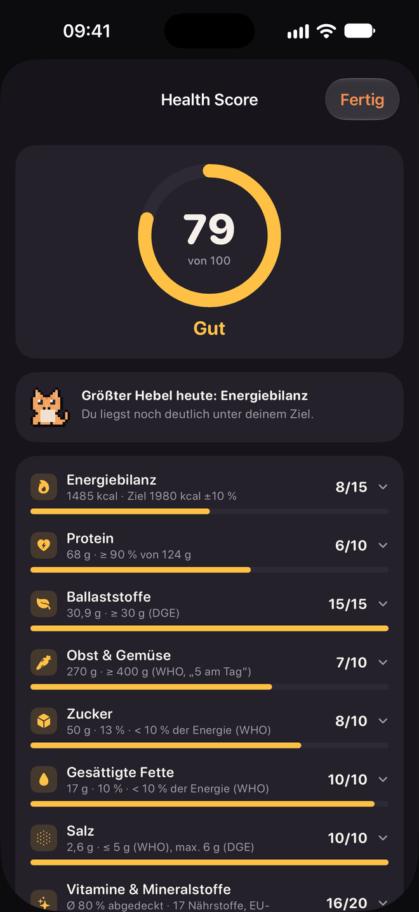
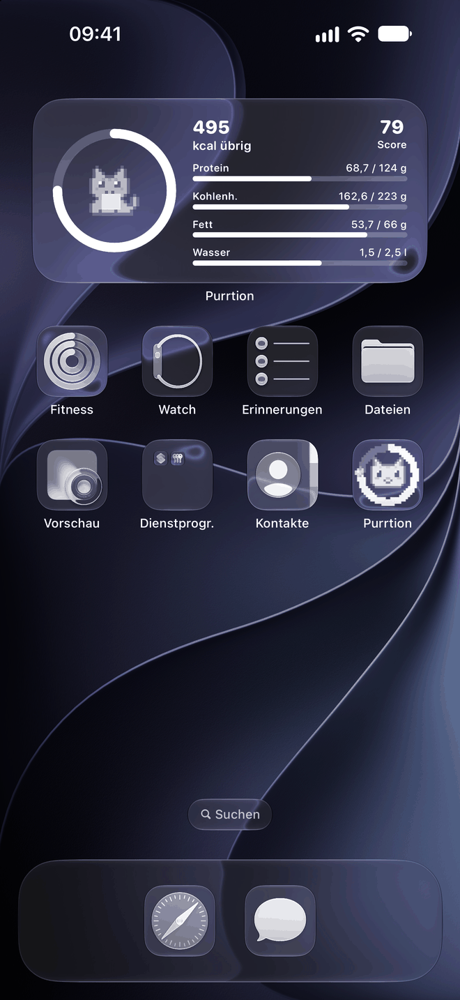
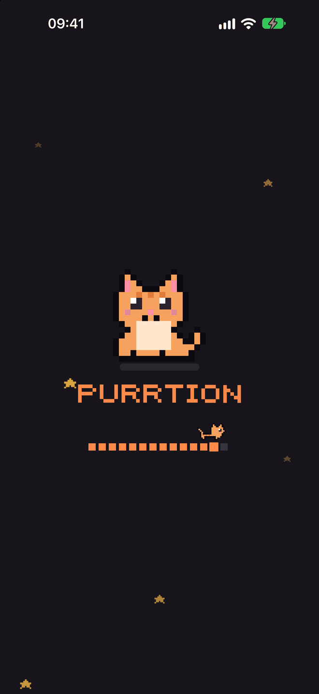

# Purrtion 🐾

Kalorientracker für iPhone (SwiftUI, SwiftData, iOS 27+, optimiert für iPhone 17/18 Pro Max), komplett im Pixel-Katzen-Look.
Keine laufenden Kosten, kein Account, alle Daten bleiben auf dem Gerät.

**Version 1.1** – siehe [CHANGELOG.md](CHANGELOG.md).

## Highlights
- Eine einfache Liste pro Tag statt Frühstück/Mittag/Abend; Rezepte und Foto-Scans bleiben ein Eintrag mit ausklappbaren Zutaten
- Schnelle Eingabe: Suche, Barcode, Foto vom Teller, Schnell-Eintrag, Favoriten, „Nochmal“ per Wischen
- Makro- und Mikronährstoffe aus dem Bundeslebensmittelschlüssel, echte Portionsgrößen
- Verlauf mit Zielfarben (grün / orange bis +5 % / rot), Wochen-, 30- und 90-Tage-Ansicht
- Health Score, Wasser, Gewicht (Apple Health), Widgets, Backup und CSV-Export
- Hell- und Dunkelmodus, Pixel-Katze mit Stimmungen und Animationen

## Screenshots

<table>
  <tr>
    <td align="center" width="25%"> <b>Heute</b></td>
    <td align="center" width="25%"> <b>Mahlzeiten</b></td>
    <td align="center" width="25%"> <b>Suche</b></td>
    <td align="center" width="25%"> <b>Details</b></td>
  </tr>
  <tr>
    <td align="center" width="25%"> <b>Verlauf</b></td>
    <td align="center" width="25%"> <b>Health Score</b></td>
    <td align="center" width="25%"> <b>Widget</b></td>
    <td align="center" width="25%"> <b>Ladebildschirm</b></td>
  </tr>
</table>

## Voraussetzungen
Xcode 27 und iOS 27 (Simulator oder iPhone).

## Starten
- In Xcode: `Purrtion.xcodeproj` öffnen → Simulator wählen → ▶︎
- Oder per Terminal (baut und startet im laufenden Simulator): `./run.sh`

> Das Projekt liegt in einem iCloud-synchronisierten Ordner. Build-Produkte im Projektordner
> brechen dort die Code-Signatur ("resource fork … not allowed") – `run.sh` legt sie deshalb in `$TMPDIR` ab.

## Datenquellen (alles kostenlos)
| Quelle | Wofür |
|---|---|
| **Bundeslebensmittelschlüssel 4.0** (Max Rubner-Institut, CC BY 4.0) | ~7.100 Lebensmittel mit bis zu 138 Nährstoffen, offline in `Purrtion/Resources/bls.json` |
| Purrtion-Beliebtliste (`PopularFoods.swift`) | ~100 Alltagslebensmittel mit Namen & echten Portionsgrößen, auf BLS-Einträge gemappt |
| Open Food Facts | Barcodes & Markenprodukte, deutsche Produkte bevorzugt, unplausible Werte markiert |

BLS aktualisieren: Excel von https://blsdb.de laden und
`python tools/convert_bls.py BLS_4_0_Daten_2025_DE.xlsx Purrtion/Resources/bls.json` (braucht `openpyxl`).

## Foto-Erkennung (Profil → Foto-Erkennung)
| Anbieter | Kosten |
|---|---|
| Apple Intelligence (Standard) | kostenlos, auf dem iPhone; Fallback: Apples Vision-Bilderkennung |
| Google Gemini | kostenloses Kontingent mit eigenem Schlüssel |
| Claude (Anthropic) | ein paar Cent pro Foto, eigener Schlüssel |
| OpenAI | ca. 1 Cent pro Foto, eigener Schlüssel |

Alle Anbieter erkennen nur Bestandteile + Mengen; die Nährwerte kommen immer aus dem BLS.
Schlüssel liegen in der Keychain, das Modell ist pro Anbieter einstellbar.

## Weitere Funktionen
- **Health Score (0–100):** acht Bereiche nach WHO, DGE, GBD 2017 (Lancet 2019) und EU-NRV – `Services/HealthScore.swift`
- **Eigene Lebensmittel & Rezepte** (Meal Prep mit Portionen) – `Models/CustomFood.swift`, `Views/CustomFoodViews.swift`
- **Sicherung:** JSON-Backup etwa täglich in einen gewählten (iCloud-Drive-)Ordner + Wiederherstellen – `Services/Backup.swift`
- **CSV-Export** (Essen, Tage, Gewicht; Semikolon + deutsches Komma für Excel)
- **Apple Health:** Gewicht in beide Richtungen – `Services/HealthSync.swift`
- **Widgets:** Homescreen (quadratisch, breit) und Sperrbildschirm – Ziel `PurrtionWidget`, Daten über App Group `group.com.const.purrtion`

## Auf dem echten iPhone installieren
In Xcode beim Ziel **Purrtion** und **PurrtionWidget** unter „Signing & Capabilities“ dein Team auswählen.
App Groups und HealthKit funktionieren auch mit einem kostenlosen Apple-Account.

## Struktur
- `Shared/` – Theme, Pixel-Sprites und Widget-Datenformat (von App und Widget genutzt)
- `Purrtion/Pixel` – Animations-Views
- `Purrtion/Models` – Nährstoffe, Lebensmittel, SwiftData-Modelle, Ziele
- `Purrtion/Services` – BLS-Datenbank, Beliebtliste, Open Food Facts, Foto-Analyse (Apple/Gemini/Claude/OpenAI), Keychain
- `Purrtion/Views` – Heute, Suche, Detail, Barcode, Foto, Schnell-Eintrag, Verlauf, Profil
- `tools/` – `make_icon.py` (App-Icon), `preview_sprites.py` (Sprite-Vorschau), `convert_bls.py` (BLS-Import)

## Lizenz & Hinweise
Der Code steht unter der [MIT-Lizenz](LICENSE): frei nutzbar, veränderbar und weitergebbar, ohne Gewähr und ohne Haftung. Die Datenquellen haben eigene Lizenzen, siehe [NOTICE](NOTICE).

Purrtion ist ein privates Hobbyprojekt und wurde mit Unterstützung von KI (Claude Code) entwickelt.
Nährwerte, Foto-Schätzungen und der Health Score sind Richtwerte und ersetzen keine ärztliche oder ernährungsfachliche Beratung.

### Lizenzen der Daten
Bundeslebensmittelschlüssel 4.0 © Max Rubner-Institut, lizenziert unter [CC BY 4.0](https://creativecommons.org/licenses/by/4.0/).
Produktdaten von [Open Food Facts](https://world.openfoodfacts.org) (ODbL), werden zur Laufzeit abgefragt.
